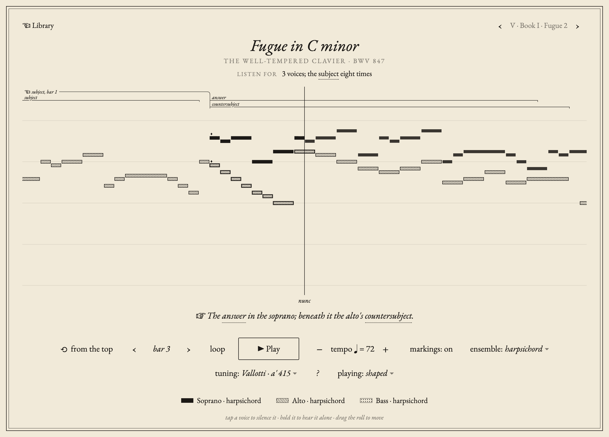

# Ohren-Übung

*bestehend in Fugen und Canons von Joh. Seb. Bach, denen Liebhabern zur Gemüths-Ergötzung sichtbar gemacht*

*(consisting of fugues and canons by J. S. Bach, made visible for music lovers, for the refreshment of their spirits)*

**[Open the app →](https://ievlevpn.github.io/viz/listening-book/)**

Ohren-Übung ("ear exercise", after Bach's own *Clavier-Übung*) is a listening companion for Bach's canons and fugues. It plays the music and draws each voice as it sounds, so you can follow the subject, see it answered, inverted, augmented or overlapped in stretto, and hear what you are looking at.



## A word before you start

I am not a musician. This is a personal project, made because I wanted to *hear* the counterpoint I could otherwise only read about. The app and its markings (where each subject enters, which entries are inverted or in stretto, the captions that explain them) were written by Claude, Anthropic's AI model, working at my direction. The markings are checked automatically against the notes of the scores, but no musician has reviewed them.

There will be mistakes. **Justified criticism is very welcome:** if a marking is wrong, a caption misleads, or something is described in a way a musician would wince at, please [open an issue](../../issues), name the piece and the bar, and say what it should be.

## What is in it

96 pieces in six collections:

- **The Musical Offering** (BWV 1079): the ten canons, the Ricercar a 3 and the Ricercar a 6.
- **The Art of Fugue** (BWV 1080): the contrapuncti, both forms of the mirror fugues, the four canons, and the unfinished final fugue.
- **The Well-Tempered Clavier, Book I** (BWV 846–869): all 24 fugues.
- **Goldberg Variations** (BWV 988): the nine canons.
- **Inventions and Sinfonias** (BWV 772–801).
- **Rounds**: one familiar round, as a gentle start.

A glossary explains the techniques (subject, answer, countersubject, inversion, augmentation, stretto, canon at the n-th, …), each with a short example you can play.

## How to use it

- **Tap a voice** in the legend to silence it; **press and hold** it to hear that voice alone.
- **Drag the roll** to move through the piece, step by bar with ‹ ›, or set a **loop** over a passage.
- Choose the **ensemble** (harpsichord, organ, strings, chamber), the **tuning** (equal temperament, Vallotti, Werckmeister III; the "?" explains each) and the **tempo**, which is remembered per piece.
- Keyboard: space plays and pauses, ← → step by bar, L sets a loop, [ ] go to the previous or next piece.
- It can be added to the home screen and works offline. "Keep everything for offline use", at the bottom of the library, downloads the whole book (about 6 MB).

## How it is built

- `prep/`: Python ([uv](https://docs.astral.sh/uv/), [music21](https://web.mit.edu/music21/)). It reads the scores, applies the hand-written markings in `prep/markings/*.yaml`, checks them against the notes, and writes one JSON file per piece to `web/public/data/`.
- `web/`: TypeScript, Vite, Canvas 2D and Web Audio. No framework and no server: it is a static site.

```sh
# data (the source scores go in prep/sources/, which is git-ignored; see prep/SOURCES.md)
cd prep && uv sync && uv run python -u -m fugue_prep.build

# app
cd web && npm ci && npm run dev      # or: npm run build, which writes web/dist

# tests
cd web && npm test
cd prep && uv run pytest
```

The built data is committed, so `prep/` is only needed to change the markings or add pieces.

## Credits and licences

- **Music:** Johann Sebastian Bach (1685–1750), public domain.
- **Note data:** read from Humdrum encodings by David Huron and Craig Stuart Sapp, from the Mutopia Project, and, for the Musical Offering canons, transcribed from the Bach-Gesellschaft edition. Data derived from Mutopia scores is shared under their licence (CC BY-SA 3.0 or public domain, per piece). The full list is in [`web/public/credits.txt`](web/public/credits.txt).
- **Sound:** FluidR3_GM samples by Frank Wen, MP3 renders by Benjamin Gleitzman ([midi-js-soundfonts](https://github.com/gleitz/midi-js-soundfonts)), CC BY 3.0.
- **Type:** EB Garamond, Garamond Libre and Noto Music, SIL Open Font License.
- **Code and markings:** MIT, see [LICENSE](LICENSE).
